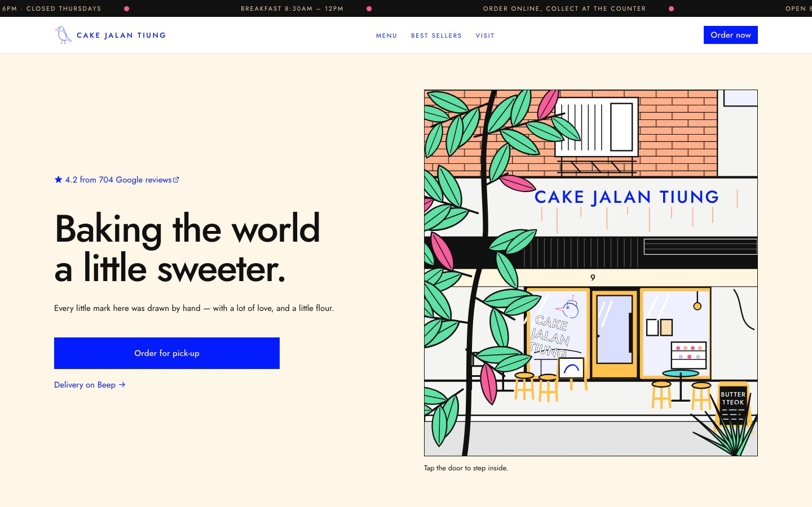
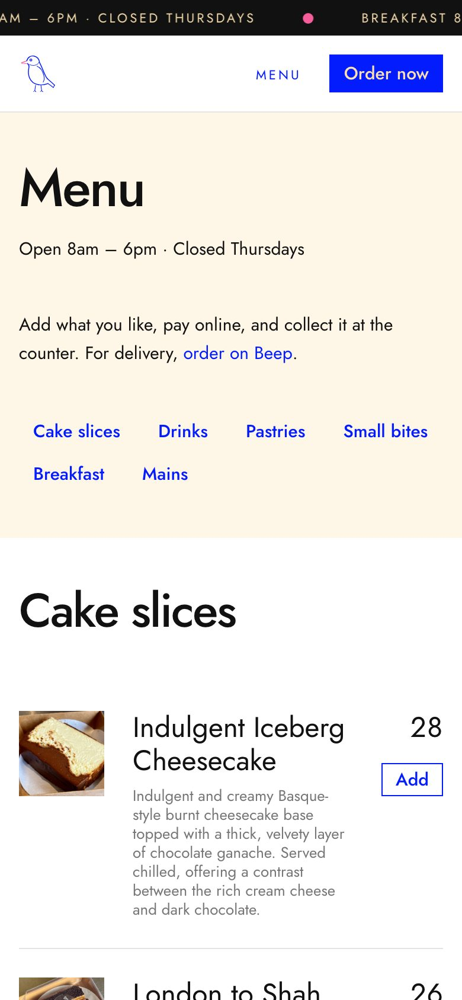
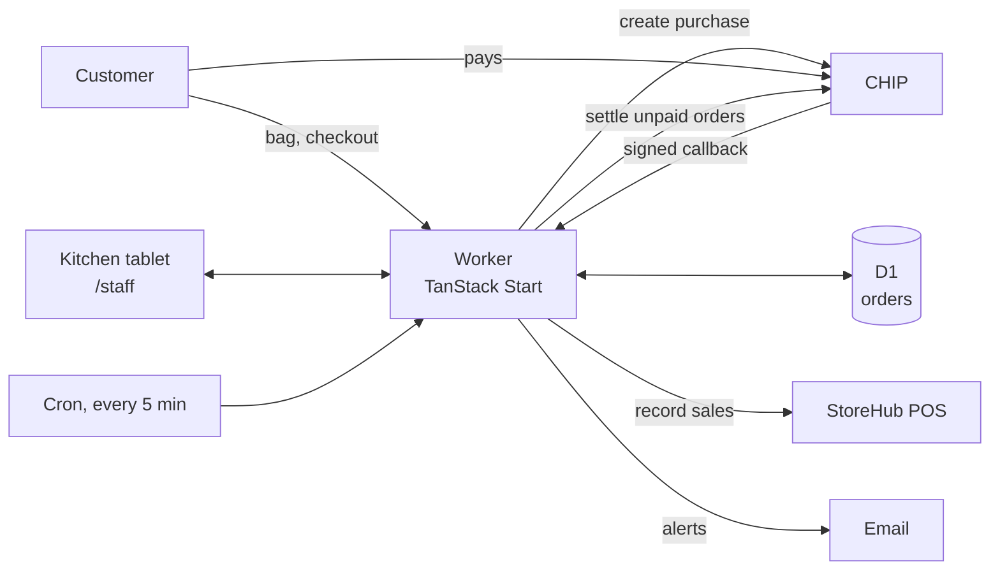

<div align="center">

# Cake Jalan Tiung

**The online shop for Cake Jalan Tiung, Seksyen 4, Shah Alam.**
Order cakes, pastries, coffee and meals online, pay by FPX, DuitNow, e-wallet or card, and collect at the counter.

[cakejalantiung.app](https://cakejalantiung.app)

</div>

<p align="center">
  
  &nbsp;
  
</p>

## What it does

| For customers | For the shop |
| --- | --- |
| Menu built for a phone: best sellers first, a category rail, one-tap + on every photo, a sheet for each dish, the next step always at the foot of the screen | Kitchen screen at `/staff` behind a PIN: new orders ring, one tap moves each along |
| A bag pinned to the foot of the screen that survives closing the tab | Pause online ordering for today, or until resumed |
| Open now and the soonest pick-up shown on the menu and the bag bar, before checkout | Mark dishes sold out until tomorrow |
| Checkout on one page with Pay pinned: pick-up time inside opening hours, details and way to pay remembered, one optional row of add-ons | A customer who taps I'm here goes to the top of the board, in pink, with a ring |
| Payment through [CHIP](https://www.chip-in.asia) (FPX, DuitNow QR, Touch 'n Go, GrabPay, cards) | Paid orders recorded as sales in StoreHub, cancelled on refund, with each order's StoreHub state on the kitchen screen |
| An order page that follows the order to Ready, with I'm here near pick-up time; the last order one tap from every page, to track or to order again | An RM 1 staff test order to try real payments end to end |
| A receipt by email once paid, and a second email once the order is ready, linking back to I'm here | Failure alerts by email |
| Delivery still through Beep | |

## How it works



- **One Worker on Cloudflare** serves the pages (server-rendered React with [TanStack Start](https://tanstack.com/start)), the server functions and the payment callback. Orders live in **D1**.
- **Money is integer sen** end to end. The browser sends only dish ids and quantities; the server prices every cart from the catalogue.
- **Order status only moves forward**, through one table in [`src/orders/model.ts`](src/orders/model.ts). Every change is a guarded `UPDATE … WHERE status IN (…)`, so a repeated or late payment event changes nothing.
- **Payments are verified twice:** CHIP's RSA signature over the raw callback body, then the purchase read back from CHIP's API.
- **A 5-minute cron** asks CHIP about orders still awaiting payment (a lost callback still reaches the kitchen; abandoned orders expire), looks for refunds made in CHIP's dashboard, and records sales in StoreHub and cancels refunded ones. A sweep that meets a wrong token or StoreHub being down stops after one call, and the kitchen screen says how many sales StoreHub is missing.

## Stack

[TanStack Start](https://tanstack.com/start) · React 19 · TypeScript · [Astryx](https://astryx.atmeta.com) design system · Cloudflare Workers, D1, Cron Triggers, Email Sending · deployed with the [`cf`](https://developers.cloudflare.com/cf/) CLI · Vitest · Playwright for layout checks

## Getting started

Needs Node 22.18 or later and pnpm.

```bash
pnpm install
cp .dev.vars.example .dev.vars   # local settings: fake payments, a local staff PIN
pnpm db:migrate:local             # create the local database
pnpm dev                          # http://localhost:5179
```

With `PAYMENTS=fake`, checkout opens a built-in test payment page and no money moves. The kitchen screen is at `/staff`, signed in with the PIN from `.dev.vars`.

| Command | What it does |
| --- | --- |
| `pnpm dev` | The site on the Workers runtime, with hot reload |
| `pnpm test` | Unit tests: pricing, pick-up times, order statuses, payments, StoreHub sales, brand rules |
| `pnpm typecheck` | Generates Worker types, then type-checks |
| `pnpm fit` | Every page at six widths; fails on anything that overflows or a console error |
| `pnpm walk` | Orders on a phone from home to paid against a running dev server, screenshot per screen; fails on a spill, a console error or a broken step. `WALK_BROWSER=webkit` walks it in Safari's engine |
| `pnpm spec` | Rendered components against the brand's Paper measurements |
| `pnpm photos` | Writes each photo in `src/assets/photos` at the widths the site shows, as WebP; run after adding one |
| `pnpm build` | Production build |
| `pnpm deploy` | Deploy to Cloudflare |

## Project map

```
src/
  routes/        pages and the payment callback (/, /menu, /checkout, /order/$id, /staff, /api/payments/callback)
  orders/        bag, checkout, order page, kitchen screen, order model, availability, D1 queries
  payments/      the payment seam: CHIP, and a fake provider for local work
  pos/           StoreHub sales sync
  ops/           the 5-minute cron and failure alerts
  site/          this shop's content: menu, hours, address, StoreHub product ids
  storefront/    reusable storefront sections, driven by the shop's content
  system/        the brand: tokens, rules, primitives, components
migrations/      D1 schema, applied in order
docs/            checkout plan and decisions, design system
```

## Deploying

```bash
pnpm exec cf d1 migrations apply <database-id>   # when migrations/ has a new file
pnpm deploy
```

The Worker needs these secrets, set with `pnpm exec cf workers secrets update <NAME> --worker cakejalantiung`:

| Secret | What it is |
| --- | --- |
| `PAYMENTS` | `chip` in production. There is no default, so a deploy cannot fall back to test payments |
| `CHIP_SECRET_KEY`, `CHIP_BRAND_ID` | The CHIP account that takes the money |
| `STAFF_PIN` | The kitchen screen's PIN, 6 digits or more. Changing it signs every device out |
| `SESSION_SECRET` | Signs staff sessions |
| `STOREHUB_API_TOKEN` | StoreHub API token, for recording sales |
| `ALERT_TO` | Where failure alerts are emailed |

The production state, what has and has not been tried live, and what is waiting on the shop are in [docs/checkout-plan.md](docs/checkout-plan.md).

## Security

- No secret is in this repository or its history. Local settings live in `.dev.vars`, which git ignores; production secrets live only on the Worker.
- Payment callbacks are accepted only with a valid CHIP signature, and the purchase is confirmed with CHIP before an order moves.
- The browser never sets a price.
- Staff sessions are HMAC-signed cookies (HttpOnly, Secure, SameSite=Strict) tied to the current PIN. PIN guessing is rate-limited per address and across all addresses.
- Only signed-in staff can order the RM 1 test item, and only real CHIP payments are ever sent to StoreHub.

Found a vulnerability? Report it privately, as [SECURITY.md](SECURITY.md) describes, not in a public issue.

## Docs

- [Checkout plan](docs/checkout-plan.md): decisions, the order model, CHIP and StoreHub findings, production state
- [Design system](docs/design-system.md): how the brand is built in code, and why

---

<sub>© Cake Jalan Tiung. All rights reserved. The code is public to read; it is not licensed for reuse.</sub>
